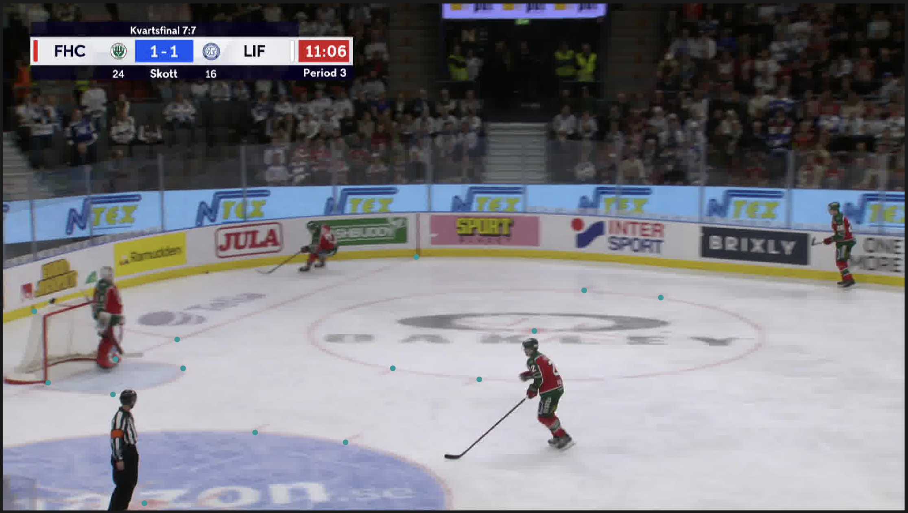

# Getting Started with FiftyOne: A Hockey Computer Vision Use Case

*How a visual dataset exploration tool helped me organize, inspect, and evaluate hockey rink landmarks.*


*AI-generated illustration.*

## Introduction

The biggest part of any project, whether you're baking a pie for Thanksgiving dessert or building a flying saucer, is having the right containers, tools, and gadgets to store, organize, and retrieve the things you need.

Working with computer vision and artificial intelligence is no different.

In fact, managing the images, annotations, and model predictions involved in a computer-vision project can sometimes be more challenging than writing the code itself.

Thankfully, the team at [Voxel51](https://voxel51.com/) has developed a tool specifically designed to help.

It's called [FiftyOne](https://docs.voxel51.com/), an open-source platform that allows developers and researchers to explore, visualize, organize, and evaluate computer-vision datasets.

Think of it as a well-organized workshop for your computer-vision projects. Instead of searching through folders of images, annotation files, spreadsheets, and model predictions, FiftyOne brings these different pieces of information together in an interactive visual environment.

As I recently discovered while working on a hockey computer-vision research project, having the right workshop makes a considerable difference.

## From Hockey Video to Computer Vision Data

My current research project, *NHL Puck Tracking & Passing Networks*, explores how computer vision, spatial mathematics, and graph theory can be combined to better understand passing behavior in ice hockey.

The long-term objective is to identify players, track puck movement, reconstruct passing events, and eventually visualize the passing relationships between teammates.

Before we can begin analyzing passing networks, we need to understand what's happening in the video.

That starts with identifying where the players, puck, and important rink markings appear in each frame.

For the rink-marking component of our project, we're building upon the work of **Mehdi Houshmand and his colleagues**, whose 2025 *HockeyRink* research introduced a dataset and pretrained computer-vision model designed to identify 56 important landmarks on an ice hockey rink [1]. These include goal-line intersections, faceoff markings, blue lines, and other recognizable rink features.

Each landmark has an identification number, from KP-00 through KP-55. When the pretrained HockeyRink model processes an image, it predicts landmark locations and confidence scores indicating how strongly the model estimates their presence.

This gives us a starting point for determining how the rink appears from the camera's perspective. A prediction, however, is not automatically proof of correct placement.

**That's where FiftyOne became useful.**

## Our First FiftyOne Experiment

We started with a small dataset containing two hockey frames and their original landmark annotations.

Rather than immediately modifying anything that looked questionable, we used FiftyOne to organize the original annotations and our experimental observations into separate layers.

This allowed us to inspect different interpretations of the same image without losing track of where the information came from.

As our research progressed, we created a second FiftyOne dataset to compare the HockeyRink researchers' original annotations with predictions generated by their pretrained neural network.

For this experiment, we used a single hockey frame containing 15 annotated rink landmarks.

The pretrained model returned 56 keypoint slots because its architecture is designed to predict all 56 possible rink landmarks.

That doesn't mean all 56 landmarks are visible in every frame.

Some landmarks might be outside the camera's view, while others may be obscured by players or the goal structure.

We needed a way to distinguish the model's raw output from the predictions worth displaying for visual inspection.



*Figure 1. Original HockeyRink landmark annotations displayed in FiftyOne. The 15 visible landmarks are shown as turquoise markers.*

### Filtering Predictions by Confidence

Using Python, we created a simple confidence filter:

```python
CONFIDENCE_THRESHOLD = 0.50

for row in rows:
    confidence = float(row["keypoint_confidence"])

    if confidence < CONFIDENCE_THRESHOLD:
        continue

    # Add the prediction to our FiftyOne display layer
```

Of the 56 possible landmarks, **15 predictions met our provisional confidence threshold of 0.50**. Those 15 landmark IDs matched the 15 landmarks present in the original source annotations.

This is a result for **one frame**, not a general benchmark of the model's performance. The threshold was chosen for convenient visual inspection, not as a validated accuracy cutoff.

It also introduced an important lesson: **a model can identify which landmarks are present without predicting their positions perfectly.**

## Seeing the Difference

This is where FiftyOne's visual interface became particularly valuable.

We created separate fields for the original annotations, the full set of pretrained predictions, and the confidence-filtered predictions. We could turn each layer on or off and inspect their positions directly on the hockey image.

We also calculated the pixel distance between each original annotation and its corresponding model prediction. Across the 15 source-present landmarks, the **mean difference was 15.685 pixels** and the **maximum difference was 26.992 pixels**.

These measurements didn't automatically tell us whether the original annotation or model prediction was correct. They told us where the two disagreed.

FiftyOne allowed us to investigate those differences visually rather than relying entirely on numerical results.

This revealed another important lesson: a model can report high confidence that a landmark is present while still placing it some distance from its original annotation.

Confidence is useful, but it isn't a guarantee of positional accuracy.


*Figure 2. Original HockeyRink annotations (turquoise) and confidence-filtered pretrained predictions (blue). Both layers can be inspected independently.*

## Preserving What We Learned

One of the features I particularly appreciate about FiftyOne is the ability to preserve different sources of information without overwriting the originals.

For our experiment, we maintained separate fields for the original annotations, raw model predictions, and confidence-filtered predictions.

We also recorded human-review observations and assigned **provisional** review statuses to landmarks requiring further investigation. We preserved the observations in versioned JSON files and in our persistent FiftyOne dataset.

This gave us a traceable record of what we observed, what we questioned, and what still needed verification.

For a research project, that distinction matters.

**An observation isn't necessarily a correction, and a proposed correction shouldn't automatically become training data.**

By keeping those stages separate, we can revisit our findings without losing the original evidence.

## What FiftyOne Does—and What It Doesn't Do

Perhaps the most useful thing I learned was understanding FiftyOne's role in the broader computer-vision workflow.

FiftyOne doesn't replace the neural network that detects rink landmarks. It doesn't automatically retrain the model when we flag a questionable prediction. And it doesn't determine the physical dimensions of an ice hockey rink.

Instead, it provides a visual environment for exploring datasets, comparing predictions, investigating potential errors, and organizing evidence for future model improvement.

For our project, that's exactly what we needed.

We can continue using pretrained models for landmark detection while relying on FiftyOne to help us evaluate the data those models produce.

## What's Next?

Our next steps involve extending this workflow to additional hockey frames, player and puck detections, and eventually passing-event recognition.

As the number of images and predictions grows, having a consistent way to organize and inspect the results will become increasingly important.

We're also developing a physical rink-coordinate system that will help transform image positions into actual distances on the ice. That will eventually support spatial analysis, including Voronoi diagrams, passing-lane evaluation, and passing-network construction.

Those are subjects for future articles.

For now, my introduction to FiftyOne has reinforced a simple lesson:

**Before trusting what a computer-vision model tells you, you need a practical way to examine the evidence.**

Sometimes, having the right tools to organize your workshop is just as important as knowing how to build what's inside it.

---

## Reference

[1] **Houshmand Sarkhoosh, M., Gautam, S., Midoglu, C., Shafiee Sabet, S., Kupka, T., & Halvorsen, P.** (2025). *HockeyRink: A Dataset for Precise Ice Hockey Rink Keypoint Mapping and Analytics.* In *Proceedings of the 16th ACM Multimedia Systems Conference (MMSys ’25)* (pp. 249–255).  ⁠https://doi.org/10.1145/3712676.3718338

**Project and tool links:** [FiftyOne documentation](https://docs.voxel51.com/) · [Voxel51](https://voxel51.com/) · [HockeyRink model on Hugging Face](https://huggingface.co/SimulaMet-HOST/HockeyRink)
