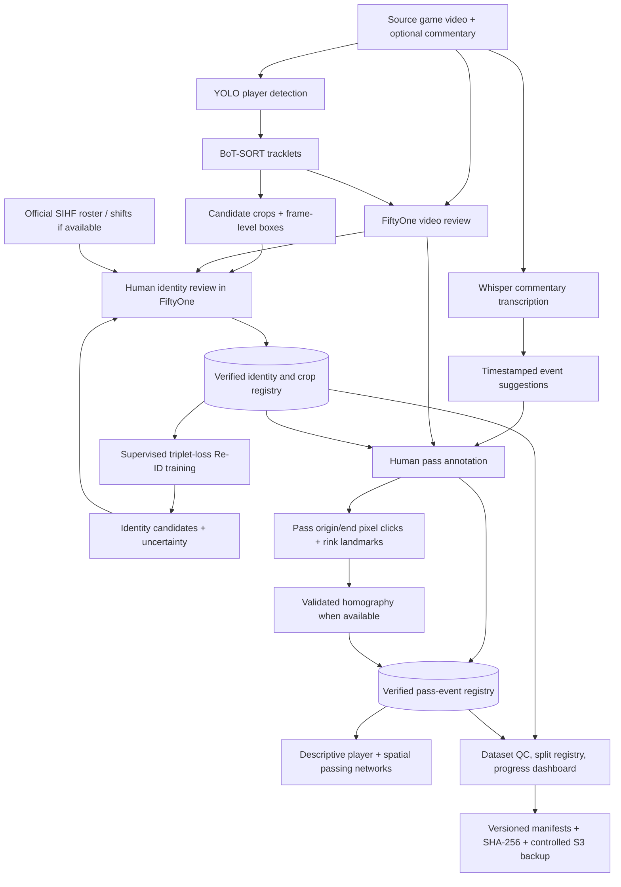

# Hockey Research Workstation — Technical Design

**Project:** NHL Puck Tracking & Passing Networks (Swiss NL Finals pilot)
**Status:** Living design draft
**Date:** 2026-11-04
**Repository destination:** `docs/capstone/HOCKEY_RESEARCH_WORKSTATION_DESIGN.md`

## 1. Purpose and definition of done

Build one integrated, reproducible workstation for reviewing broadcast hockey, gathering verified player identities, annotating attempted passes, locating events in image pixels and (when validated) rink coordinates, and producing **descriptive** passing networks.

**Capstone done means:** (1) an evaluated player detection/tracking/identity workflow with an explicit unknown option; (2) a human-auditable passing-attempt dataset with outcomes and linked participants when identifiable; (3) reproducible descriptive player and spatial passing-network outputs; and (4) documented validation, provenance, and limitations. **Not in scope:** optimal-lane recommendations, counterfactual pass-completion probabilities, and predictive passing decisions. Those belong to a later project.

> **Governing principle:** Build one reusable data infrastructure supporting multiple experiments. Detect once, track continuously, verify strategically, and reuse every validated observation.

## 2. Conceptual workflow

**Interpretation:** Model outputs and commentary are suggestions, never automatically human-verified labels. The workstation is one user experience, but may use a lightweight custom annotation panel alongside FiftyOne.

## 3. Current implementation versus proposed work

| Component | Status | Evidence / qualification |
|---|---|---|
| Experiment 07D appearance baseline | Completed | Five-image ResNet-18 feasibility test; preserve unchanged |
| Experiment 07F expanded recognition baseline | Completed | Exploratory track-disjoint Top-1 28.22%, Top-3 53.37%; temporal holdout limited |
| Experiment 07G grey-jersey enhancement | Phase 1 completed | 24 FRI crops, 96 variants, 9 identities; no demonstrated quantitative OCR improvement |
| Verified observation audit | Completed | 440 verified observations; not equivalent to 440 usable crops |
| Consolidated FiftyOne identity dataset | Completed | 1,325 image samples; 301 verified, 1,024 unverified |
| FiftyOne video playback | Working pilot | G01 P1 330–360 s; 750 frames at 25 fps |
| Commentary ON/OFF | Working pilot | Separate audio-enabled 30-second clip, H.264 + AAC |
| Whisper transcription | Working pilot | Five timestamped English segments, faster-whisper small on CPU |
| Video identity overlays | Next | Import 07E5 boxes/track IDs/verified identities with frame-offset checks |
| One-stamp notes and spatial pass annotations | Proposed | Needs usable annotation UI and export |
| Probabilistic lineup inference | Proposed | Verify availability of individual shift intervals first |
| Teammate workflow and S3 permissions | Proposed | Must test local versus shared editing and least-privilege access |

## 4. Core user workflows

### 4.1 Identity acquisition and model training

1. Select game, period, and review interval; automatically ingest existing detection/tracking outputs where available.
2. Sample informative crops across independent tracklets, camera orientations, and visibility conditions.
3. Review a strong identity anchor; associate tracklets only when continuity is trustworthy; mark identity switches or uncertainty explicitly.
4. Save official SIHF `player_id`, team, jersey, provenance, reviewer, and evidence status.
5. Export validated crops for **07G multi-frame number recognition** and **07H supervised triplet-loss Re-ID**. Sample hard negatives from same-team players, with track/game-disjoint evaluation partitions.
6. Feed model-generated candidate rankings back into the review queue, never into verified labels automatically. Later use active learning to prioritize uncertain examples.

**Collection target:** approximately 30 diverse verified crops per participating player per game, approximately 8,800 across seven games. This is a planning target, not a claim that every roster member has 30 available views. Current confirmed progress: **301 usable verified crops** in the consolidated FiftyOne dataset; 440 verified *observations* in the broader audit. The 1,024 unverified candidate crops do **not** count until validated.

### 4.2 Passing-event annotation

1. Review footage with commentary muted or enabled.
2. Optionally inspect timestamped Whisper suggestions or dictate notes. Commentary may omit routine passes; it is **not** ground truth.
3. Pause at pass initiation; create a new event with source frame/time, team, passer if known, intended receiver if known, and a pixel click at the puck origin.
4. Advance to completion/interception/termination; click observed endpoint and record outcome.
5. Attach camera view, nearest HockeyRink keypoint landmarks when available, calibration version, uncertainty, and a short note.
6. Validate and export attempted and completed passes separately for descriptive networks.

### 4.3 One-stamp annotation contract

A saved event should automatically inherit `game_id`, `period`, `source_video`, `source_frame_index`, `broadcast_seconds`, current detection/track references, and available landmark predictions. User-supplied fields include `event_type`, `passer_player_id`, `intended_receiver_player_id`, `outcome`, `origin_pixel_xy`, `destination_pixel_xy`, `camera_view`, `review_notes`, and verification state. Use a stable `event_id` to connect start/end observations. Preserve raw pixel coordinates even after rink calibration; never present estimated rink coordinates as precise measurements.

## 5. Canonical data model

- **Videos:** game/period, video hash, codec/fps, clock synchronization and camera segments.
- **Detections:** unique detection ID, source frame, bounding box, confidence, model/run version.
- **Tracklets:** run-scoped `track_uid`, start/end frames, quality, camera-cut/identity-switch flags.
- **Identity associations:** `track_uid` → official SIHF `player_id`, evidence anchor(s), source, reviewer, confidence, verified/candidate/unknown status. A track ID is **not** a jersey number or permanent identity.
- **Crops:** file hash, detection/track provenance, orientation, jersey visibility/readability, quality, split membership.
- **Transcript segments:** audio source hash, model/version, language, clip and source timestamps, raw text, corrected text separately.
- **Pass events:** event ID, start/end frames, passer/receiver candidates, attempt/outcome, transcript link, review status.
- **Spatial observations:** source pixel x/y, frame, rink landmark IDs/distances, homography version, projected rink x/y, uncertainty.
- **Lineup context:** roster, optional official shift intervals, inferred on-ice candidates, manpower, possession and spatial roles. Broadcast timestamps and game clock are separate and require alignment.

## 6. Player identity inference architecture

**Primary experimental approach:** YOLO detection → BoT-SORT tracklets → supervised triplet-loss Re-ID (initially ResNet-18; OSNet optional comparator) → jersey-number evidence → constrained temporal/spatial/lineup identity assignment.

Use same-team conditional hard-negative sampling and independent held-out evaluation. Verified identities can be **clamped** as strong anchors, but tracking errors and false anchors must remain reviewable. Positional roles and inferred line combinations are probabilistic hints, not hard rules; defenders can pinch and forwards can cover the point. Official shift records, if obtainable and synchronized, can directly constrain candidates. Unsupervised or latent-state lineup modeling is an optional experiment, not a prerequisite for collecting labels.

**07F baseline:** 28.22% exploratory image-weighted Top-1 and 53.37% Top-3 in the track-disjoint condition; source crops cover only 90 seconds of P1, so do not overclaim generalization. Maintain explicit unknown/abstain behavior and measure identity switches and calibration as well as accuracy.

## 7. FiftyOne workstation boundaries

FiftyOne currently stores crops and plays video. Native storage of custom sample/frame fields does **not** mean a complete hockey-specific note-taking and pixel-click interface already exists. Validate native annotation actions before building a minimal custom panel or companion UI. The latter should preserve the same canonical event records. Do not let multiple teammates concurrently edit one unmanaged local MongoDB dataset.

## 8. Teammate operating model

Assign games or non-overlapping review intervals; give reviewers read access to source footage and scoped write access to annotation submissions. Maintain reviewer identity, status transitions, independent QC, conflict resolution, and a progress dashboard by player/game/tracklet. Export validated submissions into versioned manifests and then synchronize to S3 with least privilege. Do not expose unrestricted bucket credentials.

## 9. Reproducibility and preservation

- Keep 07D, 07F, 07G, original crops, and historical manifests immutable.
- Use additive/versioned datasets and refuse unintended overwrites.
- Validate frame namespace: segment-local vs full-period; for the P1 330–360 s pilot, **source frame = clip frame + 8,250** at 25 fps, subject to verifying actual decoded alignment and FiftyOne's frame numbering convention.
- Keep broadcast timestamps distinct from official game clock, especially during stoppages/replays.
- Record input/output SHA-256 and code/model versions.
- Git stores code/docs, not the MongoDB database or media. The consolidated dataset's `samples.json` and `metadata.json` export is a **metadata-only** backup; test restoration and independently protect referenced media.

## 10. Workstation acceptance tests

| Test | Definition of done |
|---|---|
| Playback | Open G01, seek frames accurately, mute/unmute commentary |
| Overlays | Show correct 07E5 boxes, track IDs, and verified SIHF identities at aligned frames |
| Identity review | Verify one new tracklet and export diverse crops with hashes and reviewer provenance |
| Passing note | Pause, save event start/end frame, passer/receiver/outcome and notes |
| Spatial stamp | Click origin/end pixels; save landmark proximity and calibration status |
| Round-trip | Export and reload annotations without loss or silent schema changes |
| QC | Distinguish verified, candidate, and unknown; show progress and reject duplicates |
| Teammate handoff | Another operator completes a documented G02 pilot without heredoc editing |
| Capstone outputs | Reproduce evaluated identity results, annotated pass dataset, and descriptive networks |

## 11. Near-term implementation order

1. Inspect existing 07E5 tracking/detection JSON and verified annotation schemas (read-only).
2. Import validated 07E5 overlays into a **new version** of the working G01 video dataset; check source/clip frame mapping.
3. Implement one-stamp timestamped notes, then origin/end pixel clicks and pass-event export.
4. Integrate synchronized transcript suggestions and optional user dictation.
5. Implement verified-crop selection, diversity/quality checks, and per-player progress reporting.
6. Validate on G02, write teammate SOP, establish restricted S3 submission and backup workflow.
7. Train/evaluate triplet-loss Re-ID with leakage-resistant partitions; add lineup constraints incrementally.

## 12. Known risks and decisions pending

- Confirm availability and granularity of official shift/lineup data.
- Validate exact video/clip frame alignment and camera-cut segmentation.
- Test annotation UI capabilities and whether a companion panel is required.
- Establish permission/licensing constraints for game-video/audio sharing.
- Resolve older MongoDB compatibility warning before multi-user deployment.
- Avoid counting candidate images, near-duplicates, or merely verified observations as verified **usable crops**.
- Test FiftyOne backup restore and S3 integrity for all required media and metadata.

## 13. Checkpoint references

- Git commit: `b32bcf6cc5917b2cec01d7c833d7ce4a13b2d5bc` (pushed to `origin/main`).
- Consolidated dataset: `swiss_nl_g01_identity_review_consolidated_v1` (1,325 samples, 301 verified).
- Metadata export: `local_artifacts/fiftyone_backups/phase_02_2026_11_04/consolidated_identity_v1/`.
- Audio transcript pilot: five segments; SHA-256 manifest `09e8ceccf916e6f00d87c963947e40942f8a69775479cdec29358ab631f0c1ca`.
- Related documents: `docs/capstone/NHL_Capstone_Research_Proposal_DRAFT_2026-11-04_REVISED.md` and `docs/capstone/checkpoints/PHASE_02_WORKSTATION_2026-11-04.md`.

---

*Living specification. Update implementation statuses and acceptance-test evidence as the workstation evolves; do not rewrite historical experiment results.*
