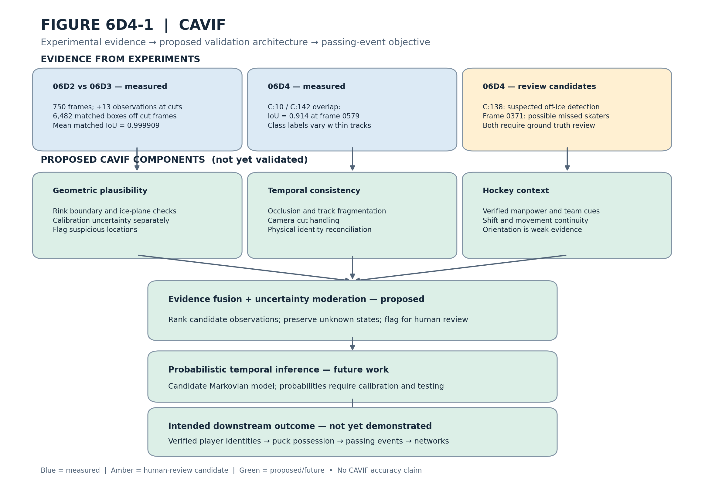

# Part I — Experimentation: Findings, Conclusions, and Research Direction

**Project:** NHL Puck Tracking & Passing Networks
**Research dataset:** Swiss National League Championship Finals, G01
**Date:** November 1, 2026
**Status:** Draft for research review

## 1. Research Objective

The objective of Part I was to investigate whether existing computer-vision technologies could provide the foundation for generating structured player-level hockey data from broadcast footage.

Our broader research goal is to identify players, maintain their physical identities, determine puck possession, and reconstruct passing attempts and outcomes for subsequent passing-network analysis.

The investigation focused on understanding, integrating, and evaluating existing technologies rather than immediately training a new model.

The principal tools included HockeyAI for object detection, BoT-SORT for multi-object tracking, HockeyRink for rink-landmark calibration, OpenCV for geometric transformations, and FiftyOne for dataset inspection and human review.

The experiments were conducted primarily using footage from Game 01 of the seven-game Swiss National League championship finals.

## 2. Demonstrated Experimental Results

### 2.1 Player Detection and Tracking

HockeyAI generated player and goaltender detections with bounding-box coordinates, classification labels, and confidence scores.

BoT-SORT associated detections across consecutive frames and generated tracking identifiers.

The resulting CSV and JSON artifacts preserved frame indices, timestamps, object classes, bounding boxes, and tracking histories.

These outputs established a reproducible foundation for analyzing player locations and temporal movement.

### 2.2 Camera-Cut-Aware Tracking

Experiment 06D compared persistent BoT-SORT tracking against camera-cut-aware tracker initialization over 750 broadcast frames.

The camera-cut-aware configuration produced 6,495 observations compared with 6,482 in the baseline, recovering 13 observations at two camera transitions.

Outside the camera-cut frames, 6,482 matched bounding-box pairs achieved mean IoU of 0.999909.

These findings demonstrate improved immediate post-cut observation availability while preserving near-identical bounding-box outputs elsewhere.

They do not establish improved physical player identity accuracy.

### 2.3 Tracking Identity and Classification Diagnostics

Experiment 06D4 investigated whether numerical tracking continuity corresponded to persistent physical player identity.

Track C:10 contained 465 observations, including 259 `goalie` classifications and 206 `player` classifications.

Track C:142 contained 174 observations, including 168 `goalie` classifications and six `player` classifications.

The two tracks exhibited substantial bounding-box overlap during crease congestion, including IoU = 0.914 at frame 0579.

These results demonstrate classification instability and overlapping tracking observations.

They do not independently establish whether the tracks represent duplicate detections or separate physical players.

### 2.4 Candidate Detection Failures

Human review identified several cases requiring further investigation.

Track C:138 was classified as a player across frames 0557–0562 but appeared to be located outside the playable ice surface.

Frame 0371 contained a crowded player cluster in which additional skaters may have been obscured.

A possible identity transition involving a blue-uniformed player wearing jersey number 6 was also observed between tracking identifiers C:24 and C:119.

These remain candidate failures pending independent ground-truth validation.

### 2.5 Rink Calibration and Spatial Geometry

HockeyRink experiments investigated landmark detection, rink-coordinate mapping, and homography estimation.

The investigations identified potential inconsistencies involving goalie-crease landmark coordinates and motivated further calibration and geometric validation.

The experiments also established the importance of distinguishing homography reprojection error from spatial plausibility measurements.

Reprojection error evaluates the accuracy of landmark mapping.

Spatial plausibility evaluates whether a detected object's estimated ice-contact point is consistent with the playable rink surface.

Reliable physical player-position estimates require validated calibration and appropriate treatment of uncertainty.

## 3. Principal Research Findings

Part I identified several limitations that affect the reliability of video-derived hockey observations.

**Detection confidence does not guarantee object validity.** A detector may assign a player classification to an official or spectator.

**Tracking continuity does not guarantee physical identity continuity.** A persistent track ID may exhibit classification instability, while a single physical player may receive multiple track identifiers.

**Occlusion complicates both detection and identity association.** Crowded gameplay creates ambiguous and overlapping observations.

**Camera transitions require explicit handling.** Tracking behavior can change abruptly when broadcast perspectives change.

**Spatial calibration requires independent validation.** Incorrect rink geometry can introduce systematic errors into player-position estimates.

These findings demonstrate why reliable player-level event generation requires more than independently applying pretrained detection and tracking models.

## 4. Proposed Research Direction — CAVIF

The experimental findings motivate a proposed **Context-Aware Validation and Inference Framework (CAVIF)**.

CAVIF is intended to integrate complementary evidence from four areas.

### 4.1 Geometric Validation

Use validated rink boundaries, landmark-based homography, and spatial plausibility constraints to identify potentially invalid player detections.

Homography calibration error and out-of-bounds distance will be evaluated separately.

### 4.2 Temporal Consistency

Use tracking histories, camera-transition information, occlusion reasoning, and identity reconciliation to investigate fragmented or inconsistent player tracks.

### 4.3 Hockey-Specific Context

Incorporate verified manpower conditions, team affiliation, shift continuity, player positioning, and gameplay constraints.

Because hockey is a collision sport, player head orientation and movement direction must be treated as supporting contextual evidence rather than definitive indicators of puck possession.

### 4.4 Uncertainty Moderation and Probabilistic Inference

Combine imperfect evidence while preserving uncertainty.

A future elementary Markovian model may estimate hidden states such as physical player identity, puck location, and possession.

Initial probabilities would be documented assumptions requiring calibration and experimental validation.

The first implementation of CAVIF will flag questionable observations for review rather than automatically removing them.

**CAVIF remains a proposed architecture. Its effectiveness has not yet been demonstrated.**

### Supporting Research Schematic

Figure 6D4-1 connects measured experimental findings and human-review candidates to the proposed validation architecture.

The figure distinguishes measured evidence, preliminary observations, and proposed capabilities.

## 5. Experimental Methodology — Physical AI Data Flywheel

Our research follows an iterative process consistent with the Physical AI Data Flywheel discussed by Brian Moore of Voxel51.

The process consists of:

**Collect Data → Run Inference → Inspect Results → Identify Failures → Develop Improvements → Reevaluate**

FiftyOne supports dataset inspection and human review within this process.

Our experiments illustrate the approach.

The camera-cut investigation identified missing observations, introduced a controlled tracking modification, and measured the resulting differences.

The identity-validation investigation revealed classification and tracking ambiguities that motivate further evaluation and proposed contextual improvements.

This iterative methodology emphasizes reproducibility, measurable changes, and preservation of original experimental evidence.

The data flywheel describes how the research process improves over successive experiments.

CAVIF describes the proposed technical architecture intended to improve observation validation and probabilistic inference.

## 6. Next Development Milestone — Persistent Physical Player Identity

The next development milestone is to investigate persistent physical player recognition across broadcast footage.

Our seven-game Swiss National League Finals dataset provides repeated observations of two competing teams and a relatively constrained set of candidate player identities.

The proposed development approach will combine team classification, jersey-number recognition, visual appearance features, tracking continuity, and human validation.

Initial experiments will focus on a small set of verified players and evaluate identity recognition against independently reviewed observations.

Future work will investigate puck detection, puck-player association, possession inference, and passing-event generation.

The eventual objective is to produce structured records identifying passing attempts, passers, intended and actual receivers, and outcomes.

These records will support the team's parallel passing-network analysis workstream.

## 7. Conclusion

Part I established a reproducible experimental foundation for developing a hockey-specific computer-vision pipeline.

The research demonstrated functional player detection, image-space localization, timestamped tracking observations, and measurable improvements in immediate post-camera-cut observation availability.

It also identified limitations involving physical identity recognition, object classification, occlusion, and rink calibration.

These limitations motivate CAVIF as a proposed framework for combining geometric, temporal, and hockey-specific contextual evidence with uncertainty-aware probabilistic reasoning.

The principal contribution of Part I is therefore both technical and methodological: a reproducible experimental process that identifies limitations, preserves evidence, and motivates testable improvements.

**The next phase will focus on persistent physical player identity recognition as a prerequisite for reliable puck-possession and passing-event extraction.**

The long-term objective remains generating usable player-level passing data directly from hockey broadcast footage and transforming those observations into reproducible passing networks.