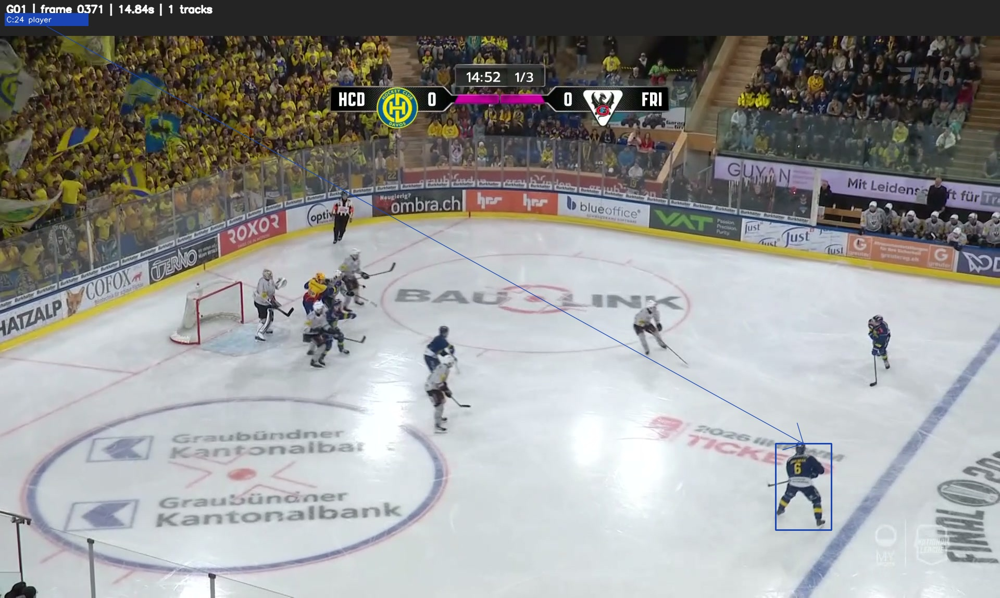
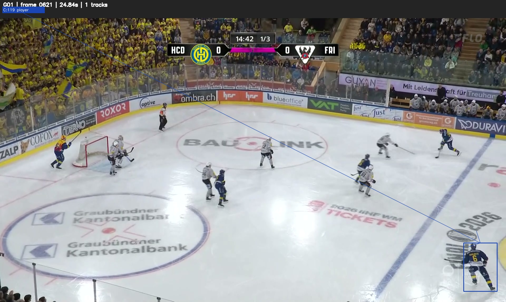
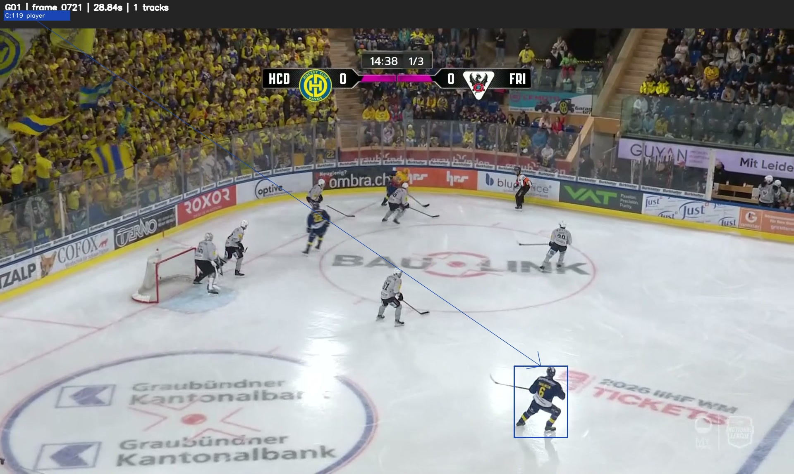
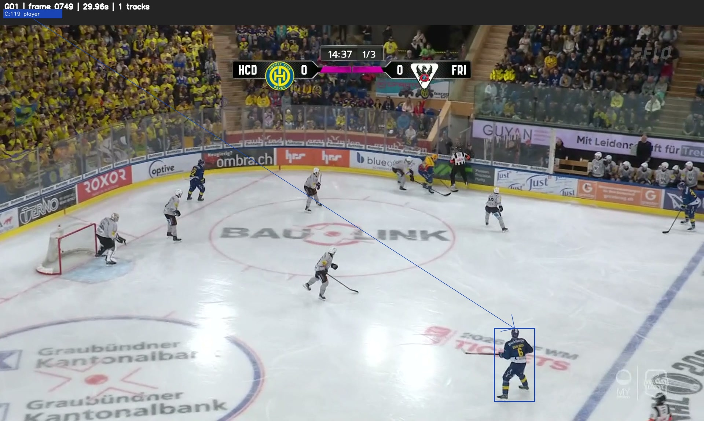

# Experiment 07 — Persistent Physical Player Identity Recognition

**Project:** NHL Puck Tracking & Passing Networks
**Dataset:** Swiss National League Finals — G01
**Baseline:** Experiment 06D3 Camera-Cut-Aware BoT-SORT
**Date:** November 1, 2026
**Status:** Active investigation

## 1. Research Objective

Investigate whether fragmented BoT-SORT tracking identities can be associated with persistent physical hockey players using visual evidence, temporal continuity, and hockey-specific contextual information.

The initial investigation focuses on tracking identifiers C:24 and C:119 in Camera Segment C.

The broader objective is to develop a reproducible player-identity recognition process that supports the project's video-classification MVP and subsequent puck-possession and passing-event extraction.

## 2. Experimental Findings

### Finding 07.1 — Candidate Track Identity Fragmentation

**Initial observation**

C:24 and C:119 form a candidate identity-reconciliation pair with temporally separated observations near the broadcast image boundary.

The available visual evidence was initially insufficient to confirm shared physical identity.

**Recorded tracking evidence**

| Measurement | C:24 | C:119 |
|---|---|---|
| First frame | 0325 | 0520 |
| Last frame | 0499 | 0749 |
| Observations | 175 | 230 |
| Classification | Player | Player |
| Missing observations within track span | 0 | 0 |

The tracks are separated by 20 intervening frames (0500–0519).

At 25 frames per second, the elapsed time between their endpoint observations is 0.84 seconds.

Their endpoint bottom-center coordinates are approximately 34 pixels apart in image space.

**Initial interpretation:** The temporal separation, spatial proximity, and consistent classification supported further investigation but did not independently establish shared physical identity.

### Finding 07.2 — Hockey Context Supports Candidate Identity Continuity During Partial Occlusion

The C:24/C:119 transition illustrates how temporal continuity, partial visual evidence, and tactical context can support an identity hypothesis when jersey-number recognition is unavailable.

Human review identified intermittent visibility of the player's helmet near the bottom image boundary.

The short elapsed interval and offensive-zone positioning suggested that the same defenseman may have remained on the ice.

A developing passing sequence toward the blue line provided additional tactical context.

**Initial interpretation:** These observations supported a plausible identity-continuity hypothesis.

However, the absence of an observed substitution did not prove that a substitution was impossible.

This case motivates further evaluation of context-aware identity reconciliation within the proposed CAVIF architecture.

### Finding 07.3 — Partial-Visibility Tracking Continuity

Track C:119 maintains a consistent short-term association with a blue-uniformed skater across frames 0520–0528 as the player becomes increasingly visible near the blue line.

The player was identified as a candidate receiver in a human-reviewed passing sequence.

At the time of this observation, physical identity and the proposed C:24/C:119 association remained unresolved.

**Interpretation:** Partial visibility near the broadcast image boundary represents a relevant challenge for player detection and persistent identity tracking.

### Finding 07.4 — Candidate Jersey-Number Association

Human review identified HC Davos jersey #6 near the blue line in frames 0371, 0621, 0721, and 0749.

Tracking observations suggested the following associations:

- Frame 0371: C:24
- Frame 0621: C:119
- Frame 0721: C:119
- Frame 0749: C:119

These candidate associations motivated targeted tracking overlays for visual verification.

### Finding 07.5 — Human-Verified Physical Player Identity Association

Targeted tracking overlays confirmed that the highlighted player wore HC Davos jersey #6 in all four reviewed frames.

| Frame | Track UID | Team | Jersey | Verification |
|---|---|---|---|---|
| 0371 | C:24 | HC Davos | 6 | Human visual review |
| 0621 | C:119 | HC Davos | 6 | Human visual review |
| 0721 | C:119 | HC Davos | 6 | Human visual review |
| 0749 | C:119 | HC Davos | 6 | Human visual review |

### Visual Evidence — HC Davos #6

The following four frames provide human-reviewed visual evidence
that BoT-SORT assigned two tracking identifiers to HC Davos #6.

**Frame 0371 — Track C:24**

**Frame 0621 — Track C:119**

**Frame 0721 — Track C:119**

**Frame 0749 — Track C:119**

**Interpretation:** The highlighted player wears HC Davos
jersey #6 in each reviewed frame. This establishes a
human-verified association between physical player HC Davos #6
and BoT-SORT tracks C:24 and C:119 at the selected observations.

The result does not establish that every observation belonging
to either track is correctly associated with that player.

**Result:** The reviewed observations establish that C:24 and C:119 were assigned to the same physical player, HC Davos #6, at different times.

This provides a verified example of physical player identity fragmentation across BoT-SORT tracking identifiers.

The result does not automatically verify every observation belonging to either track.

## 3. Related Passing-Event Observation

During the identity investigation, human review identified a passing sequence involving HC Davos players.

The puck was reported visible in multiple frames between 0504 and 0519.

A blue-uniformed skater near the blue line subsequently appeared to receive and control the puck.

Track C:119 was associated with the partially visible skater beginning at frame 0520.

The player's stick and puck were reported visible during the subsequent sequence, particularly around frame 0526.

**Current status:** Human-reviewed candidate completed pass.

The exact release frame, reception frame, passer identity, and independently verified outcome remain to be documented.

This observation is preserved separately from the confirmed physical player identity association.

## 4. Implications for CAVIF

The investigation demonstrates the importance of distinguishing numerical tracking identities from physical player identities.

It also provides a concrete development example for the proposed Context-Aware Validation and Inference Framework.

Potential identity-reconciliation evidence includes:

- Team affiliation and jersey-number recognition.
- Visual appearance similarity.
- Temporal continuity.
- Camera framing and partial visibility.
- Spatial plausibility.
- Hockey-specific tactical context.

These signals should be evaluated without assuming that they are independent.

The initial implementation should preserve uncertainty and flag candidate associations for review rather than automatically merging tracks.

## 5. Next Experimental Milestone

The next phase will expand the human-verified identity reference dataset.

The initial verified records are stored in:

`local_artifacts/hockeyai_test/swiss_nl_2026_finals/G01/experiment_07/identity_reference/verified_player_observations.csv`

Future work will:

1. Identify additional players with clearly visible jersey numbers.
2. Associate verified identities with existing tracking observations.
3. Extract player appearance references.
4. Develop an initial automated identity-recognition baseline.
5. Evaluate identity recognition and false associations on independent footage.

The initial C:24/C:119 investigation is development evidence and must not be treated as an independent evaluation result for a model developed using these observations.