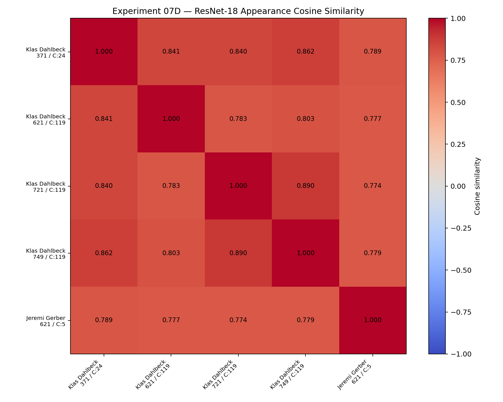

# Experiment 07D — Appearance Embedding Baseline

**Project:** NHL Puck Tracking & Passing Networks
**Dataset:** Swiss National League Finals — G01
**Date:** November 1, 2026
**Status:** Initial experiment completed; follow-up research planned

## 1. Research Objective

Investigate whether pretrained visual embeddings can distinguish individual hockey players across broadcast frames and support persistent physical player identity recognition.

This experiment builds on Experiment 07C, which established human-verified player observations associated with official Swiss Ice Hockey Federation (SIHF) player identifiers.

The initial experiment evaluates general-purpose ImageNet embeddings as a baseline before investigating models trained specifically for person re-identification.

## 2. Experimental Configuration

**Model:** ResNet-18
**Pretrained weights:** IMAGENET1K_V1
**Framework:** PyTorch 2.9.0 / Torchvision 0.24.0
**Embedding dimensions:** 512
**Similarity metric:** Cosine similarity
**Inference device:** CPU

The final ImageNet classification layer was replaced with an identity operation to expose the model's 512-dimensional feature representations.

The resulting embeddings were normalized to unit length before calculating pairwise cosine similarity.

### Dataset

Five human-verified player crops representing two physical players:

| Player | SIHF ID | Team | Observations |
|---|---|---|---:|
| Klas Dahlbeck #6 | 340162 | HC Davos | 4 |
| Jeremi Gerber #61 | 308637 | Fribourg-Gottéron | 1 |

The experiment produced six unique same-player comparisons and four different-player comparisons.

This was a development-set feasibility experiment, not an independent identity-recognition evaluation.

## 3. Mathematical Methodology

For two nonzero embedding vectors, cosine similarity is calculated as:

\[
\operatorname{sim}(\mathbf{a},\mathbf{b})
=
\frac{\mathbf{a}\cdot\mathbf{b}}
{\|\mathbf{a}\|\|\mathbf{b}\|}
\]

After unit normalization, cosine similarity equals the dot product of the normalized vectors.

The implementation included mathematical checks using known vectors, embedding-dimension validation, finite-value checks, and similarity-matrix symmetry and diagonal checks.

These checks verify mathematical and computational behavior. They do not establish physical player-recognition accuracy.

## 4. Experimental Findings

### Finding 07D.1 — General-Purpose Embeddings Do Not Consistently Separate Player Identities

The initial similarity matrix showed overlapping scores between same-player and different-player observations.

Two particularly informative comparisons were:

| Comparison | Cosine similarity |
|---|---:|
| Dahlbeck frame 0621 vs. Dahlbeck frame 0721 | 0.783 |
| Dahlbeck frame 0371 vs. Gerber frame 0621 | 0.789 |

The different-player comparison produced a slightly higher similarity than the same-player comparison.

This demonstrates that raw cosine similarity from the pretrained ResNet-18 representation does not perfectly separate physical identities in the initial dataset.

### Finding 07D.2 — Different Uniform Colors Do Not Guarantee Embedding Separation

Dahlbeck and Gerber wear visibly different team uniforms.

Nevertheless, their embeddings exhibited substantial similarity.

A plausible explanation is that ImageNet-pretrained ResNet-18 emphasizes visual characteristics useful for general object classification, including features shared by hockey players, rather than features optimized for distinguishing physical individuals.

The experiment does not establish which specific visual features dominate the embeddings.

### Finding 07D.3 — Cosine Similarity Is Not Identity Probability

A cosine similarity score is a mathematical measure of directional alignment between embedding vectors.

It is not a calibrated probability that two images depict the same physical player.

Consequently, a similarity of 0.789 must not be interpreted as a 78.9% probability of shared identity.

The observed overlap also demonstrates why selecting an arbitrary similarity threshold would be insufficient for reliable identity reconciliation.

### Figure 07D-1 — ResNet-18 Appearance Similarity

The similarity matrix demonstrates overlapping same-player
and different-player similarity scores.

The figure represents development-set observations and
does not establish generalizable identity-recognition accuracy.

## 5. Research Interpretation

The experiment successfully demonstrated a reproducible workflow for:

- Extracting learned visual representations.
- Normalizing embedding vectors.
- Calculating pairwise cosine similarities.
- Comparing human-verified physical identities.
- Identifying limitations in general-purpose visual representations.

However, the results do not establish reliable automated player recognition.

The initial dataset is extremely small, contains only two physical players, and does not include a same-team different-player comparison.

Additionally, multiple comparisons share the same underlying images and are not statistically independent.

## 6. Key Research Proposition — Identity-Discriminative Embedding Learning

The observed limitations motivate investigating embeddings trained specifically for physical person re-identification.

Rather than relying exclusively on features learned for general object classification, the next research stage will evaluate identity-discriminative representations.

A promising approach is metric learning using an anchor, positive, and negative observation.

For example:

**Anchor:** Klas Dahlbeck, frame 0371
**Positive:** Klas Dahlbeck, frame 0721
**Negative:** Jeremi Gerber, frame 0621

Triplet-loss training seeks to reduce the distance between observations of the same identity while increasing separation from different identities.

A common formulation is:

\[
L=\max(0,d(a,p)-d(a,n)+m)
\]

Where \(m\) represents the required separation margin.

This objective is more directly aligned with physical player re-identification than general ImageNet object classification.

The current dataset is insufficient for meaningful hockey-specific fine-tuning.

## 7. Proposed Development Architecture

The next stage will investigate a pretrained person re-identification model, beginning with OSNet.

The model will be evaluated against the existing ResNet-18 baseline before any hockey-specific training.

The longer-term architecture will combine:

**HockeyAI Detection → Team Classification → Identity-Discriminative Embeddings → Jersey Recognition → Official SIHF Player ID → Temporal Identity Reconciliation**

These components will contribute evidence to the proposed Context-Aware Validation and Inference Framework (CAVIF).

Team affiliation and official game lineups will constrain candidate identities.

Appearance embeddings will contribute visual similarity evidence.

Temporal tracking and hockey-specific context will support identity persistence when direct visual identification becomes unavailable.

Uncertain observations must remain unresolved rather than receive forced identity assignments.

## 8. Hockey-Specific Dataset Development

The official G01 lineup contains 44 players, with 22 listed for each team.

Seven Swiss National League Finals games provide repeated observations of the competing teams.

The initial dataset-development target is approximately 200 diverse, human-verified player crops representing 10 physical players.

This is a planning target for feasibility testing, not a validated minimum training requirement.

Future expansion may require substantially more examples.

The dataset should include different viewing angles, partial occlusions, camera transitions, and multiple players wearing nearly identical uniforms.

### Cross-Uniform Evaluation

An additional research requirement is evaluating player recognition across different uniform appearances.

Where footage permits, the same physical player should be observed wearing contrasting uniforms in different games.

The proposed evaluation will distinguish:

1. Same-player, same-uniform comparisons.
2. Same-player, different-uniform comparisons.
3. Different-player, same-team comparisons.
4. Different-player, opposing-team comparisons.

Cross-uniform recognition is particularly important for determining whether the model learns transferable physical identity features rather than relying primarily on clothing appearance.

Actual uniform changes must be verified in the available footage.

## 9. Next Experimental Milestones

**Experiment 07D2 — Pretrained Person Re-Identification Baseline**

Evaluate OSNet using genuine Re-ID-trained weights against the existing ResNet-18 baseline.

**Experiment 07E — Hockey Identity Reference Dataset**

Expand human-verified player observations using HockeyAI detections, BoT-SORT tracking, official SIHF player identifiers, and FiftyOne-assisted review.

**Experiment 07F — Hockey-Specific Metric Learning**

Investigate fine-tuning using identity-discriminative learning objectives once sufficient verified training data is available.

**Experiment 07G — Identity Persistence Evaluation**

Evaluate recognition and track reconciliation on held-out footage, including same-team and cross-uniform conditions.

## 10. Conclusion

Experiment 07D demonstrated that pretrained visual embeddings can be extracted and compared reproducibly using cosine similarity.

However, the initial results exposed overlapping similarity scores between same-player and different-player observations.

This finding motivated a more appropriate research direction: evaluating pretrained person re-identification models and eventually investigating hockey-specific metric learning.

The principal contribution is not a claim of successful automated identity recognition.

It is the experimentally motivated transition from general-purpose visual similarity toward identity-discriminative representations, supported by official player identifiers, verified observations, and uncertainty-aware contextual reasoning.

**The next objective is to determine whether a Re-ID-trained embedding model provides better physical player discrimination than our original ImageNet baseline.**