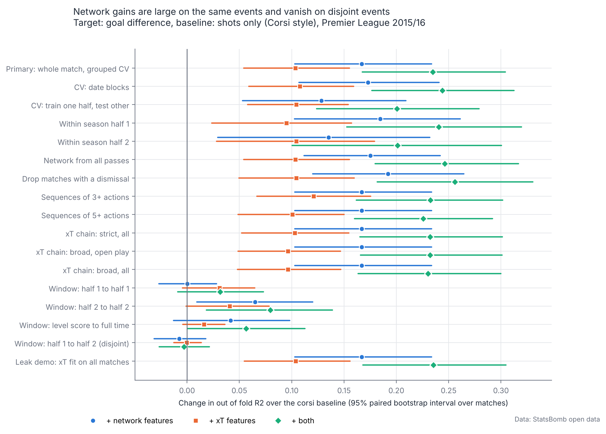
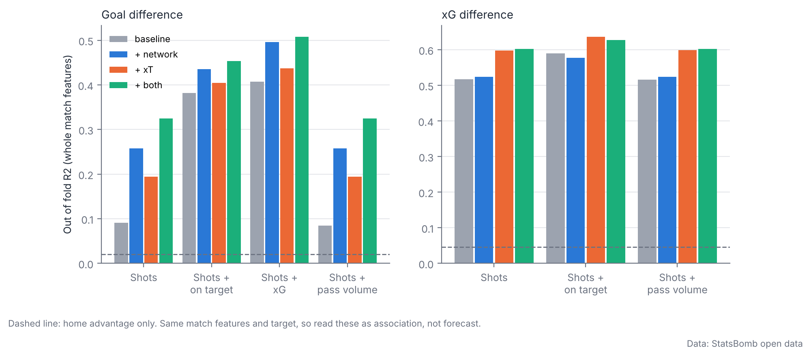

# Step 8: do network and xT features add to Corsi style shot metrics?

Data: StatsBomb open data, Premier League 2015/16, 380 matches, 760 team matches. Target: team match goal difference (and xG difference). Everything below is out of fold, grouped by match. Intervals are 95% paired bootstrap intervals over matches (2000 resamples). Full tables are in `outputs/tables/incremental_comparisons.csv` and `incremental_model_scores.csv`. Seeds are in `config/project.yaml`.

## Headline

Primary setting: whole match features, grouped 10 fold CV repeated 10 times, strict open xT chain, open play networks. Cells are the change in out of fold R2 with a 95% paired bootstrap interval over matches.

| Target | Baseline | Baseline R2 | + network | + xT | + both |
|---|---|---|---|---|---|
| gd | corsi | 0.091 | +0.167 [+0.103, +0.234] | +0.103 [+0.054, +0.155] | +0.235 [+0.168, +0.304] |
| gd | corsi_sot | 0.382 | +0.053 [+0.015, +0.095] | +0.022 [-0.005, +0.050] | +0.072 [+0.029, +0.117] |
| gd | corsi_xg | 0.407 | +0.089 [+0.042, +0.137] | +0.030 [+0.005, +0.057] | +0.101 [+0.053, +0.152] |
| gd | corsi_vol | 0.084 | +0.173 [+0.109, +0.238] | +0.110 [+0.060, +0.162] | +0.241 [+0.174, +0.311] |
| xgd | corsi | 0.517 | +0.007 [-0.019, +0.033] | +0.080 [+0.040, +0.121] | +0.085 [+0.040, +0.130] |
| xgd | corsi_sot | 0.589 | -0.012 [-0.025, +0.002] | +0.047 [+0.019, +0.076] | +0.038 [+0.005, +0.070] |
| xgd | corsi_vol | 0.516 | +0.009 [-0.016, +0.035] | +0.083 [+0.042, +0.125] | +0.087 [+0.042, +0.132] |

Same events versus disjoint events (target goal difference, baseline corsi):

| Window (features to target) | Baseline R2 | + network | + xT | + both |
|---|---|---|---|---|
| Primary: whole match, grouped CV | 0.091 | +0.167 [+0.103, +0.234] | +0.103 [+0.054, +0.155] | +0.235 [+0.168, +0.304] |
| Window: half 1 to half 1 | 0.107 | +0.000 [-0.027, +0.028] | +0.031 [-0.004, +0.065] | +0.032 [-0.009, +0.073] |
| Window: half 2 to half 2 | 0.095 | +0.065 [+0.009, +0.120] | +0.041 [-0.001, +0.078] | +0.080 [+0.019, +0.139] |
| Window: level score to full time | 0.079 | +0.042 [-0.013, +0.098] | +0.016 [-0.004, +0.036] | +0.056 [+0.000, +0.113] |
| Window: half 1 to half 2 (disjoint) | 0.032 | -0.007 [-0.032, +0.018] | -0.000 [-0.013, +0.014] | -0.003 [-0.027, +0.021] |

## What the numbers say

* **Same match association is large for goal difference.** Over shots alone, network features raise out of fold R2 from 0.09 to 0.26, xT features to 0.19, and both to 0.33. The gain shrinks but survives stronger baselines (shots on target, shots plus xG): network plus 0.05 and plus 0.09, xT plus 0.02 and plus 0.03. Adding raw pass volume to the baseline changes nothing, so the gain is structure, not how many passes a team completed.
* **It is stable across every robustness check we ran.** Date block CV, train on one half and test on the other, within half runs, all passes instead of open play passes, dropping matches with a dismissal, sequences of 3 or more and 5 or more actions, and all four Markov configurations give the same picture. No chain configuration is a clear winner: xT differences between them are about 0.01 in R2, far inside the intervals. The primary configuration (strict, open play) was fixed before looking, and it stays the default.
* **The xT zone values did not leak.** Refitting zone values inside each training fold, versus fitting them on all 380 matches, changes the xT gain by less than 0.001. We keep the in fold refit as the safe default.
* **Network features do not explain xG difference.** For the xG target the network gain is about 0.01 with an interval that includes zero, while xT adds 0.08 (interval 0.04 to 0.12). Network features help with goals but not with the quality of chances created.
* **The network gain disappears on events that do not overlap the target.** Features from half 1 predicting goal difference in half 2 give a network change of minus 0.007 (interval minus 0.032 to plus 0.018) and an xT change of 0.000. When features are taken only from events while the score is level, the network gain falls to plus 0.04 with an interval that includes zero, and is negative against a pass volume baseline.

## What the test can and cannot show

* Features and target come from the same match, so this is an explanatory association, not a forecast. Network features and Corsi are measured over the same 90 minutes as the goals they are asked to explain.
* The pattern (network features track goals but not xG, and fade when measured before the goals or in the other half) fits a score effect: teams that lead or trail change how they pass. That reads the scoreboard into the network, so the large same match gain should not be taken as evidence that structure causes goals. This is consistent with the data, not proven by it.
* The disjoint window test is low powered. Half 1 shots explain only 3% of half 2 goal difference. The interval says a network gain above about 0.02 R2 is unlikely in this design, but small gains cannot be excluded.
* xT adds to the xG target in every same window setting (whole match, half 1 to half 1, half 2 to half 2, level score), which is what a measure of territory and chance creation should do, but not in the disjoint half 1 to half 2 window (change 0.000, interval minus 0.013 to plus 0.009). So we have not shown that it forecasts anything.
* One season, 380 matches. Ridge regression only, so nonlinear structure is not tested. Seventeen settings are reported without a multiplicity correction. Resampling matches does not model the fact that each team appears in 38 matches, so intervals are somewhat optimistic about team level effects.
* Corsi here means StatsBomb shots (blocked shots included); missed attempts that StatsBomb does not log as shots are absent.

## Suggested next test

A forecasting version: features from a team's previous matches (leaving the current match out) predicting the next match, which removes score effects by construction. It needs the season order already used for the date block CV and would be a natural step 9 item.
